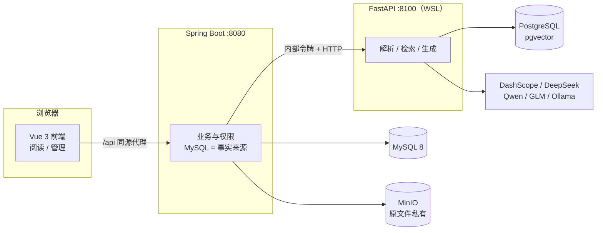

<div align="center">

# Book_Agent

**基于原文的 Book 阅读与协作写作助手**

文章与 Book 统一为同一内容模型：三栏阅读界面、AI 问答严格基于当前原文检索并附真实出处、
流式打字机回答、受限 Agent 计划与学习路线。Java 是业务事实来源，Python 负责解析、向量与模型调用。


</div>

## 功能特性

**内容与阅读**
- Book 管理：在线 Markdown 编写或上传 PDF / DOCX / TXT / MD 直接成书，分类树 + 多标签，修订快照与版本恢复
- 发布状态机 `DRAFT → PUBLISHED ⇄ OFFLINE`，公开内容匿名可读；导出 Markdown / PDF，ZIP 整库备份与恢复
- 三栏阅读界面（目录 / 原文 / 对话），PDF 保留页码定位，桌面双栏可收起，手机互斥抽屉

**AI 问答与检索**
- RAG 问答：pgvector HNSW + 中文关键词混合召回，gte-rerank-v2 重排，回答固定「结论 + 可点击出处」，无依据时明确说明
- 跨 Book 全库检索与多文档总结 / 对比，知识范围支持多选 Book、分类文件夹与混选
- 登录对话 SSE 流式打字机预览，`done` 帧携带服务端校验后的完整结果，历史会话持久化、跨设备恢复
- 上下文管理：Token 预算、滚动意图摘要、相关旧问题召回、Agent 步骤记忆、长文分段润色

**写作与学习**
- 协作写作任务：提纲 → 扩写 → 润色，每阶段人工确认，最终另存为新草稿并自动索引
- 笔记与 Agent 工作台：整理 / 润色 / 查重 / 关联推荐 / 多书合并预览，受限计划逐步手动执行
- 学习中心：按授权 Book 生成逐周学习路线，打卡、掌握度自评、薄弱点与带出处的阶段报告

**平台**
- 个人账号与所有权，Book 级 VIEWER / EDITOR 分享；旧文章数据幂等迁移，旧链接保持可用
- 网页与 GitHub / GitLab 仓库快照采集，自动分类标签，内容未变跳过重复索引

## 系统架构



- **权限与时序**：每个公开操作在耗时调用前后核验发布状态与修订号，完成校验不过即拒绝，不留过期结果。
- **流式契约**：SSE 只做预览，落库与展示以校验后的 `done` 帧为准，与整段接口共用同一契约。
- **密钥边界**：模型密钥只存环境变量，仓库与配置文件不含明文。

## 快速开始

### 环境要求

| 组件 | 要求 |
| --- | --- |
| Java / Maven | Java 21、Maven 3.9+（Windows） |
| Node | 22+（前端构建与测试） |
| Python | WSL Ubuntu + Python 3.12、[uv](https://docs.astral.sh/uv/) |
| 基础设施 | 运行中的 MySQL 8（:3306）、MinIO（:9000）、pgvector PostgreSQL（:5433） |

```bash
# WSL 内安装 uv（如尚未安装）
curl -LsSf https://astral.sh/uv/install.sh | sh
```

### 安装与启动

```powershell
# 1. 首次初始化向量库（在已有 pgvector 容器内建专用库，不清空现有数据）
powershell -ExecutionPolicy Bypass -File scripts/Setup-RAG.ps1

# 2. 首次安装前端依赖
cd frontend; npm ci; cd ..

# 3. 三个终端分别启动
powershell -ExecutionPolicy Bypass -File scripts/Start-Backend.ps1
powershell -ExecutionPolicy Bypass -File scripts/Start-AI.ps1
powershell -ExecutionPolicy Bypass -File scripts/Start-Frontend.ps1
```

| 入口 | 地址 |
| --- | --- |
| 公开书库 | <http://127.0.0.1:5173> |
| 管理台（需登录） | <http://127.0.0.1:5173/admin/books> |
| 接口文档 | <http://127.0.0.1:8080/doc.html> |
| AI 健康检查 | <http://127.0.0.1:8100/health> |

启动脚本在缺少 `.env` 时自动生成随机内部服务令牌；数据库结构由后端启动时自动初始化，开发环境默认管理员 `admin / admin123`（已有管理员不会被重置，部署时务必覆盖）。

### 模型配置

主渠道默认使用 DashScope 兼容地址的 `qwen3.8-flash`，在 **Windows 用户环境变量**设置 `DASHSCOPE_API_KEY` 后重启 AI 服务（Linux 直接向服务注入同名变量）。备用渠道（DeepSeek / Qwen / GLM）在项目根 `.env` 写入对应 `*_API_KEY`；本地模型设置 `OLLAMA_ENABLED=true` 并拉取 `qwen3:8b`。嵌入默认 `text-embedding-v4`（1024 维），可用 `EMBEDDING_PROVIDER=local` 切换 FastEmbed `bge-small-zh-v1.5`。自定义渠道顺序或分档时复制 `ai/config.yaml` 为 `ai/config.local.yaml` 并在 `.env` 设置 `AI_CONFIG` 指向它。

没有可用模型时任务明确进入失败态，可配置后重试；不会返回伪造结果。

## 运行测试

```powershell
# 一次执行 Java 测试与打包、Python 全量、前端测试与生产构建
powershell -ExecutionPolicy Bypass -File scripts/Test-Project.ps1 -WithVectorDatabase
```

当前基线：**Java 44 / Python 96 / 前端 51** 项通过。其中 6 项真实 pgvector 用例需要 `-WithVectorDatabase` 或 `TEST_PGVECTOR_DSN`，否则自动跳过；测试只创建并清理自己的临时表，不触碰业务数据。分层执行：

```powershell
cd backend;  mvn test;  mvn package -DskipTests
cd frontend; npm test;  npm run build
```

```bash
cd ai && UV_PROJECT_ENVIRONMENT=~/book-agent-venv uv sync --locked
~/book-agent-venv/bin/pytest -q
```

## 部署

`deploy/nginx.conf` 提供同源反向代理模板（History 路由回退、100MB 备份上传、内部端口不外露）。部署时通过环境变量覆盖数据库、MinIO、管理员的开发默认值，`DASHSCOPE_API_KEY` 注入服务环境。详细步骤见 [docs/部署说明.md](docs/部署说明.md)。

## 项目结构

```
Book_Agent/
├── frontend/            # Vue 3 + Vite：三栏阅读、管理台、测试（Vitest）
├── backend/             # Spring Boot 3.5 + MyBatis-Plus + Sa-Token：业务与权限
│   └── src/main/resources/db/schema.sql   # 建表结构（启动自动初始化）
├── ai/                  # FastAPI：解析、pgvector 检索、模型调用（uv 管理）
├── scripts/             # Windows 启动 / 测试 / RAG 初始化脚本
├── deploy/              # Nginx 部署模板
└── docs/                # 功能清单、接口文档、部署说明
```

## 文档

| 文档 | 内容 |
| --- | --- |
| [功能清单](docs/功能清单.md) | 全部已实现功能、入口路由、验证记录与当前边界 |
| [接口文档](docs/接口文档.md) | API 约定、鉴权规则、错误语义、流式 SSE 契约 |
| [部署说明](docs/部署说明.md) | 生产环境配置、备份策略、资源限制 |

## 当前边界

- 面向单实例部署；多实例任务租约与高可用未实现。
- 支持文本型 PDF / DOCX / TXT / MD；OCR、Excel / PPT 解析未实现。
- MinIO 签名下载链接有效 120 秒，无法即时撤销。
- 登录后对话持久化；尚无离线编辑合并与实时共同编辑。
- 浏览器验证覆盖 Chrome 桌面与手机视口；Safari / Firefox 未完整验证。
- 公网部署模板已备，尚未完成一次真实上线验收。
